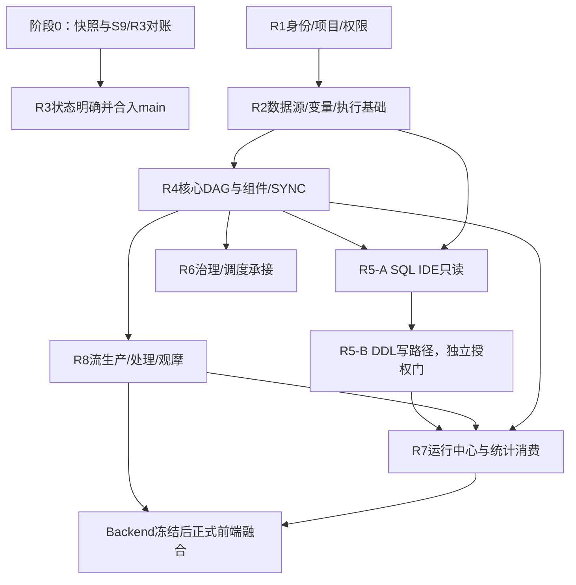

# Datara 纠偏重构实施计划（执行附录）

> 状态：供实施协作执行的计划附录；不替代、不改写产品目标真源。
>
> **权威依据**：`docs/increments/2026-10-14-datara-platform-rebuild-design.md`、`docs/increments/2026-10-14-datara-platform-rebuild.md` 及其 2026-10-16 用户批准修订章。原设计/计划定义目标与能力，本文只组织纠偏后的实施、协作、验证和管理。发生冲突时，先停受影响工作并提交用户裁定，不以本文默默降低原目标。
>
> **本轮客户重点**：以用户确认的九项业务要求组织验收切片；最终能力仍须覆盖权威原设计和计划。九项优先级不构成对其余原定能力的删除授权。

## 1. 目标与执行原则

在保护已有用户工作、已完成迁移结果及可复用证据的前提下，恢复并交付客户实际需要的重构系统。优先把 IDE、同步表单、统一变量、SQL/Python/Shell 文件、依赖表单、通用 DAG、实时生产流观摩、重点组件和运行统计做成可真实运行、可核查的闭环；然后按权威计划完成其余增量和正式前端融合。

执行遵守以下规则：

1. `docs/increments/2026-10-14-datara-platform-rebuild-design.md` 是唯一产品设计真源；同名计划正本及经用户批准的 2026-10-16 修订章是增量和顺序真源。评审修订版、执行附录、代码快照和 Trae 产物都只是参考或执行材料。
2. 实施顺序采用经批准的 **9 个增量：R0–R4、R5-IDE、R6–R8**。不得把旧 I 编号列表或 12 增量旧稿重新作为第二套门禁。
3. 重排只调整工作组织，不删减原设计能力。特别是变量七级作用域、SQL IDE 的只读和 DDL 双门禁、统计四表、实时流生产与观摩等能力不得被“先交付客户最小范围”替代。
4. 新 Backend 独立实现。旧 Backend、正式旧前端、历史 I 任务只用于行为对照、数据和资产盘点；旧能力不等同新系统验收。
5. 先定共享契约，再分离文件域并行。共享数据库模型、迁移序列、工作流版本、变量解析、执行尝试和统计语义必须单写者维护。
6. GREEN 代表按合同完成实现和验证，不代表客户验收。只有用户授权/确认的门禁才算客户 PASS。

## 2. 用户要求到权威目标的追踪

| 用户重点 | 权威增量/能力 | 端到端验收结果 |
|---|---|---|
| 1. 数据开发 IDE，参考 DBX；存储过程、函数等编辑；表/视图跨 schema 查询 | R5-IDE（R5-A 只读，R5-B DDL 写入）；依赖 R1/R2 数据源能力 | 多 schema 浏览、跨 schema 查询、分页/取消/多结果；查看/编辑例程；权限、影响预览、确认发布、审计和失败回滚；记录 DBX 对照版本及验收样例 |
| 2. 同步工作流组件表单重做，支持探查映射和用户调整 | R4-SYNC，依赖 datasource 元数据、变量、版本及执行契约 | 选源/目标、探查表字段、生成初始映射、修改并保存版本、预览/执行、核对映射与结果 |
| 3. 全局变量规范，编辑/引用校验、现值、补全 | R2 VariableService 与 R4/R5/R6/R8 全部消费者 | 七级作用域和优先级一致；编辑及所有引用输入均类型/作用域校验、补全、显示来源和现值；运行快照可追溯 |
| 4. SQL 上传文件；Python/Shell 上传脚本 | R4 资源版本服务与三个执行器 | 上传类型/大小校验、不可变资源版本、工作流绑定明确版本、运行可追溯；禁止隐式绑定 latest |
| 5. 依赖组件表单参考 DolphinScheduler | R4 Dependency 表单/执行器 | 选工作流/任务、周期/日期范围、AND/OR 条件预览、保存、运行，覆盖满足/失败/超时 |
| 6. 工作流分类去掉 ETL，归一普通 DAG | R4 核心 Palette，正式前端融合按后端冻结门禁 | 新建统一 DAG；旧 ETL 定义、版本和运行历史可兼容打开和追溯；不删除历史数据 |
| 7. 实时流处理需有生产流工作流验证 | R8 Stream 运行时、R2-06 观摩链路 | 可控速生产带唯一事件号数据，贯通 Kafka/处理/聚合融合/落地，真实观测速率、积压、offset、窗口、失败样例并可重放核数 |
| 8. DAG 组件框精简，重点 SQL/Python/Shell/Dependency，另含同步/流 | R4 Palette 与 R8 流组件 | 默认展示重点组件和必要控制流；其它组件保留为扩展/兼容，不批量删除既有实现或历史定义 |
| 9. 工作流监控后台记录成功/失败记录数 | R4/R8 统计生产、R7 消费展示；权威完整目标为统计四表 | SQL、SYNC、Python、Shell、Dependency、Stream 都写入统一 attempt 统计；计数、重试幂等、权限隔离和监控检索一致 |

## 3. 当前状态及开工前对账

已知快照说明（截至 2026-10-16；需以执行时最新 main/worktree 重新验证）：

- canonical main 上恢复版设计/计划才是权威；当前 Codex 工作树为 `bec06af` detached checkout，含未提交的纠偏设计文档，不是 canonical main，不能把该树的旧版本计划当权威。
- canonical main 工作树有多项已暂存、未暂存及未跟踪文件，且有多个 R 系列/I 系列 worktree。它们的所有权和归属不能从 `git status` 猜测。不得清理、覆盖或以脏 main 为基础直接派发实现。
- R3-S9 状态有冲突：`docs/increments/R3-execution-status.md` 的较早状态仍写 PARTIAL/REMOTE_VALIDATION_CLOSEOUT；后续交接记录 44 条导入、1 条跳过、0 错误，复核 44 unchanged/0 conflict，用户接受复合证据 PASS 并记录 S9 complete。**不得再次导入；不得把此结果自动扩大为整个 R3 完成或已合 main。**先核验范围、提交、main 集成及台账状态，由单写者修正状态记录。
- R4-SYNC 当前只见 RED/影响分析/xfail 契约；在 R3 状态、验收边界和 main 集成证据对清前，不解锁 R4 GREEN。
- 新 Backend 当前已见 identity/project/datasource/governance 等域；不得声称 legacy API/executors 是新 Backend 完成。IDE、工作流执行、变量、资源、SYNC、STREAM、统计新域须逐项核实当前最新 main。
- R5 前端可见 RED 骨架和 `NOT_WIRED` 标记；I8 有 `I8_STREAM_NOT_WIRED` 骨架记录。它们是待接线合同，不是功能 PASS。
- authoritative 原计划要求的运行统计为 `workflow_result_stat`、`task_instance_data_stat`、`task_data_stat_segment`、`task_data_error_sample` 四表与统一采集器；不是只做一张汇总表。客户要求的成功/失败数纳入这个完整目标。

### 阶段 0：恢复唯一事实基线（所有 GREEN 派工前）

- [ ] **0.1 只读盘点 main、分支和 worktree。** 在 canonical repo 执行 `git status --short --branch`、`git worktree list --porcelain`、逐 worktree 记录 HEAD、branch、dirty/untracked 文件及 owner。产物：唯一快照表，不改、不删除任何工作区。
- [ ] **0.2 对照文档权威链。** 逐项核对原设计/计划正本、2026-10-16 修订章、R3 状态、handoff 后续消息、R4/R5/I7-I9 影响分析与证据。凡旧标题或摘要与后续裁定冲突，以日期更晚且有证据/用户裁定的记录为调查起点，不自动改台账。
- [ ] **0.3 解决 S9 范围与集成事实。** 确认用户复合 PASS 覆盖哪些子项、相关代码/证据在哪个提交及是否进入 canonical main；禁止重放导入。共享台账由声明的单写者追加“事实/证据/影响/未决项”，用户判断范围时请求裁定。
- [ ] **0.4 形成差异和复用矩阵。** 对每个现存实现/RED 页面/证据归类：保留并集成、修正后复用、仅供行为参考、冲突待用户裁定。禁止以文件存在或测试骨架存在推断功能已接通。
- [ ] **0.5 固定运行基线和风险。** 按约法记录本地静态检查、后端/前端基线，区分旧失败与本次回归；只从干净隔离 worktree 复现。远程部署/浏览器验收使用 `192.168.1.9`、`http://192.168.1.9:18091/` 和项目批准的隔离资源。
- [ ] **0.6 放行决定。** Codex 提交对账证据给用户及质量监督员。只有 R3 被明确关闭并具备 main 集成证据，才允许按权威计划启动依赖它的后续 GREEN。S9 已有的有效 PASS 不重复操作。

## 4. 两条协作线与权限边界

### 4.1 实施协作线

| 角色 | 责任 | 写入边界 |
|---|---|---|
| 用户 | 唯一产品范围、设计变更、外部写入/部署/导入、DDL、验收和破坏性动作裁定者 | 不承担页面操作员职责；只需批准具体、可审查的门禁材料 |
| Codex 执行负责人 | 新 Backend owner；拆任务、冻结共享契约、派发与心跳、传达用户命令、整合和单点 main 集成 | `datara-backend/`；共享 handoff/台账须先声明单写者，不与 Trae 并写 |
| Trae 实施负责人 | Web 与独立验证页面 owner；承接 frontend API 集成、RED 页、正式前端融合（满足门禁后） | `datara-web/` 及明确分配的专属 evidence 子目录；不写 Backend |
| Codex 子智能体 | 独立 backend 域审计或实现，按任务卡在单独 worktree 工作 | 被明确授予的唯一文件域；不能共享模型/migration/API 文件写权 |
| Trae 子智能体/实现成员 | Web 独立页面、组件表单、浏览器验证等 | 每任务独立 worktree、路径和 evidence 目录；不跨入 Codex owner 域 |
| 质量监督评审员 | 独立复现基线、设计追踪、代码/交付物审查、根因分类、证据和风险记录 | 默认只读审查与记录；修改代码/文档需用户授权；不得自审自批 |

如果 Trae 质量监督员与某项实施者是同一人/会话，该项必须由另一独立评审者复核，执行者不能签核自己的交付。

### 4.2 质量监督管理线

质量监督员独立于实施线，按每个增量和用户提出的问题即时审查：

1. 复现基线：干净 detached worktree，记录实际 commit、命令、退出码和真实结果；不采信聊天转录中的测试数字。
2. 设计覆盖：逐项对照权威设计/计划和客户追踪矩阵；区分设计偏差、实现缺陷、证据缺失和环境问题。
3. 交付审计：检查路径所有权、契约、数据迁移、权限、浏览器自驱动、错误/成功用例、恢复行为和完整远端运行证据。
4. 问题管理：按 P0（数据/权限/越权/阻断验收）、P1（关键闭环缺失或错误）、P2（局部质量/可用性）、P3（非阻塞）登记根因、证据、责任人、复核条件；关闭项保留原始失败证据。
5. 质量输出：每轮产生“执行线×状态×证据”表、设计追踪表、开放问题、根因与下一步动作。报告只建议放行；用户拥有验收决定权，Codex 负责流程门禁和传令。

### 4.3 handoff 心跳和管理节奏

`docs/handoff/2026-10-16-并行协作分工.md` 是当前任务级信道，按项目约法 append-only。实际修改前先读取最新内容并声明共享文件单写者；接收人处理后标 Resolved。每次心跳使用：

```text
### YYYY-MM-DD HH:mm Sender → Recipient（R# / 主题）
- 任务与客户闭环：
- worktree / 分支 / HEAD：
- 文件 owner 与路径：
- 状态：RED / GREEN / 证据 / 提交（分别说明，不混为一态）
- 本轮证据和链接：
- 阻塞/共享依赖/用户裁定：
- 下一步与预计产物：
- 质量监督意见 / 未关闭问题：
- Resolved: <日期 by 接收者>（接收后填写）
```

频率：启动、每个关键状态变化、阻塞、准备合入和增量收口时回报；不以无信息的高频消息制造负担。可并行任务必须并行；若串行，心跳写明共享依赖或门禁依据。

## 5. 并行分工和依赖

### 5.1 立即可并行：阶段 0 的只读任务

每项独立 worktree/专属报告，互不写共享文件，由 Codex 汇总：

| 槽位 | 子智能体任务 | 产出 | 明确禁止 |
|---|---|---|---|
| A | main/分支/worktree/提交/dirty 文件和 owner 盘点 | 快照清单、合入候选和用户文件风险 | 不清理、不 checkout 覆盖、不合并 |
| B | R3-S9、R4-SYNC、现有 RED 与交接记录对账 | 每项状态、原始证据、门禁和冲突列表 | 不重复导入、不部署、不 GREEN |
| C | SQL IDE、变量、数据源元数据、旧/新域实现矩阵 | 能复用与不可依赖边界、关键依赖 | 不把 legacy 作为新后端交付 |
| D | SYNC、依赖组件、脚本资源、ETL 历史兼容盘点 | 用户流程/契约差异/风险 | 不更改正式前端 |
| E | Stream 运行时、生产观摩、统计四表与当前指标证据 | 完整统计/流闭环映射和真实状态 | 不创建远端 Kafka 数据或做写操作 |

### 5.2 契约冻结后可并行的 GREEN 实现

仅在阶段 0 和当前增量门禁满足后执行；每个包独立 worktree、唯一 owner、路径不重叠：

| 并行包 | 后端/前端 owner | 先决条件 | 汇合点 |
|---|---|---|---|
| R5-A SQL IDE 只读链路 | Codex：`datara-backend/rebuild/sql_ide/`；Trae：R5 专属 validation 页面和 evidence | R1/R2 datasource、权限、对象能力矩阵、执行/日志契约稳定；R4/R3 gate 满足 | 对象树、补全、跨 schema 查询、分页/取消、多结果和远端页面证据 |
| R2 VariableService + 变量验证页 | Codex：变量 API/service/model 由单一 owner；Trae：专属验证页/前端消费 | 七级变量 schema、优先级、类型/作用域校验、快照接口先冻结 | 配置时现值/补全与运行快照一致 |
| R4 独立验证页面 RED 与表单研究 | Trae：SYNC/依赖/资源验证页各自专属路径；Codex 只审接口契约 | RED 合同定义完成；允许 RED 时即可并行，不代表 GREEN | 每页能真实自驱动且有明确 NOT_WIRED 阶段状态 |
| R4 后端执行子域 | Codex 执行负责人统管 Backend；不同 agent 仅可认领不共享目录的 adapter/service，单写者负责基础执行器/结果/migration | 执行器输入输出、版本、attempt、变量、资源、统计契约冻结；R3 gate 通过 | SQL/Python/Shell/Dependency/SYNC 同一执行协议和统计口径 |
| R8 流后端与流观摩页 | Codex：stream runtime 单一后端 owner；Trae：I8 validation/evidence owner | Kafka/topic、attempt/checkpoint、metrics/result schema 与环境核准 | 生产工作流—Kafka—处理—落地—真实监控闭环 |
| R7 监控读取 API/UI | Codex：只读查询 API；Trae：监控消费页 | R4/R8 统计写入者字段及幂等契约已冻结 | 四表查询、筛选、实例/错误样本跳转 |

可并行的 RED 设计、契约、独立验证页和无共享文件的后端 adapter 必须通过多子智能体执行；共享基础设施任务另列单 owner，不得以“并行”为名制造同文件竞争。

### 5.3 强制串行的共享对象

- 数据库 schema、migration revision 编号/校验和、ORM 公共模型：一个 owner 编写；其他人提交接口/字段建议，不直接并改。
- workflow/version/task/attempt/run snapshot、变量优先级及解析、错误语义、状态机：一个契约负责人冻结后消费者并行。
- `docs/increments/` 主台账、handoff、Docker compose、`AGENTS.md`：每轮明确单写者。
- 同一远端 schema 的 migration/apply、真实数据导入、部署/重启、用户确认的 DDL：按约法逐次单线程执行，并保留快照和证据。
- canonical main 合并：Codex 单点负责；先 merge-tree 预检、逐提交/路径审查、全量门禁和独立复核。

### 5.4 依赖图



R5 IDE 与 R4 核心开发按原设计可并行；图中的连接表示共享前置和集成验证关系。只能在 datasource/permission/execution/variable/metrics 合同具备且 R3/R4 所需 gate 解锁后进入对应 GREEN。R5-A PASS 不授权 R5-B DDL。R8 的研究、影响分析和 RED 可先并行，流处理 GREEN 必须等 Kafka/attempt/checkpoint/metrics 契约和环境准备完成。

## 6. 九增量执行方案

下表遵循批准的 R 顺序；客户重点决定每增量演示闭环优先级，不允许越过原计划的先决门禁。

| 增量 | 核心范围 | 客户优先验收点 | 可并行包 | 退出门禁 |
|---|---|---|---|---|
| R0 | 环境隔离、当前代码/数据/资产快照、远程资源证据 | 保护客户数据和既有成果；明确 worktree 基线 | A–E 只读盘点 | owner/差异/证据和远端运行条件可复核 |
| R1 | 新 Backend 身份、项目、数据源、最小权限和验证页 | IDE/SYNC 可选择受项目权限保护的数据源 | 后端 auth/project 与独立页面可分域 | 登录/退出、权限拒绝、datasource probe 与隔离证据 |
| R2 | 数据源元数据能力、变量体系、执行基础、实例/快照和时间戳 | 跨 schema 元数据；变量校验、补全、现值、快照 | metadata、变量验证 UI、IDE R5-A impact/RED | 数据源能力矩阵、七级变量语义、共享执行合同、DB 时间戳证据 |
| R3 | I18-I23 carry-forward、治理基线和权限/迁移收口 | 已完成 S9 事实准确保留，不重做一次性操作 | 只读审查可并行；GREEN/远端写动作单 owner | 子项范围、复合证据、代码合入 main 和台账一致；用户批准的 R3 exit |
| R4 | FLOW/SYNC/SQL/PYTHON/SHELL/DEPENDENCY；资源版本；映射表单；统计生产 | 客户重点组件与同步映射、脚本/SQL 上传、依赖表单、通用 DAG | 独立 validation RED；合同冻结后非重叠 executor adapters | R3 gate；真实 SYNC 探查/调整/运行；SQL/Python/Shell/Dependency 成功失败；统计统一写入 |
| R5-IDE | R5-A 查询浏览只读；R5-B 例程/对象 DDL 写入 | DBX 对照 IDE、跨 schema 查询、函数/存储过程编辑 | A 链路后端/专属页分域并行；B 的影响分析可先 RED | A 的对象/查询全项远端 PASS 后再单独开启 B 确认、备份、审计、回滚门禁 |
| R6 | 原计划治理/运行及调度承接能力（按修订章映射） | 继续原设计不可删减项 | 独立模块在契约确定后并行 | 本增量业务、权限、迁移及真实证据齐全 |
| R7 | 调度增强、任务中心/实例、四表统计消费和查询 | 后台工作流监控及成功/失败/跳过记录 | 统计读 API 与不重叠监控 UI | SQL/SYNC/Python/Shell/Dependency/Stream 数据一致；实例/attempt/filter/project 隔离 |
| R8 | Kafka 流运行时、生产观摩工作流、AI/跨域系统验收按原设计映射 | 能持续产生实时流数据并验证处理正确性 | RED 页面/流场景方案可提前；GREEN 受共用合同约束 | 生产、消费、积压、offset、窗口、错误样例和落地核对为真实运行证据；系统级验收 |

### R0–R3：基础与治理收口

- [ ] 依阶段 0 的清单恢复所有 worktree owner、用户未提交状态和门禁事实；每个现存 worktree先评估认领/继续/只读提取/隔离保留，禁止自动清理。
- [ ] 核验 R1/R2/R3 已有 PASS 的证据、环境与当前 main commit；旧版本日志不能自动代替当前复现。
- [ ] R2 按原设计固定变量 `run > task > workflow > project > global > env > builtin`；编辑/引用控件统一调用服务，返回值、来源、类型、作用域及 validation errors，执行创建不可变解析快照。
- [ ] R3 解决 S9 状态冲突后，提交明确映射和影响；若用户接受的复合 PASS 覆盖范围有限，只补其未完成的证据/代码集成，不重复导入已完成资产。

### R4：客户重点工作流闭环

- [ ] 冻结 executor API：节点配置、workflow version、attempt、cancel/retry、变量快照、结构化结果、错误样本、日志引用、资源版本和统计写入语义。
- [ ] 完成 SQL、Python、Shell adapter；SQL/Python/Shell 表单均调用统一变量校验服务；SQL 上传 `.sql`，Python/Shell 上传允许脚本文件，资源内容以不可变版本绑定。
- [ ] 完成 Dependency 表单/执行：目标 workflow/task、周期或日期范围、AND/OR 条件可预览；表单交互参考 DolphinScheduler，但执行由 Datara 新服务负责。
- [ ] 完成 SYNC：源/目标 datasource、模式/对象探查、字段映射生成与人工调整、转换/目标属性编辑、映射随版本保存、全量/增量、批次提交、失败样例、检查点和重跑语义。
- [ ] Palette 默认集合仅含客户重点节点与必要控制节点；ETL 成为普通 DAG 的用途/模板；既有 ETL 定义、版本、实例、URL 和运行证据必须可追溯。
- [ ] 按权威设计落地完整四表与统一 collector：`workflow_result_stat`、`task_instance_data_stat`、`task_data_stat_segment`、`task_data_error_sample`。按 attempt_no 隔离重试，汇总幂等；结构化计数独立于日志保留策略。数据库生成 required timestamps。
- [ ] 提供独立浏览器验证页：实际创建 DAG、选择数据源、配置组件、上传版本化脚本、变量校验、保存/发布/试跑/执行并查看结果；页面只验证，不替代正式前端。

### R5-IDE：只读与写操作分门

- [ ] R5-A：对象树覆盖 DB/schema/table/view/column/index/function/procedure/trigger；SQL 补全、跨 schema 查询、权限矩阵、执行限制、结果分页、取消、多结果、历史、资产和导出；只读远端实测并独立验收。
- [ ] R5-B：在 R5-A PASS 后单独申请 DDL 授权；覆盖例程/对象 definition 查看编辑、语法校验、权限/依赖/影响分析、diff/备份、用户确认、执行审计、失败补偿/回滚。任何用户确认语不得由 agent 代填。
- [ ] DBX 为交互参考，不作为数据库执行/安全模型的权威；在原型评审和验收证据中明确对照的 DBX 版本/链接/截图。

### R6–R8：调度、监控、流和最终验收

- [ ] R6 按原设计完成治理、运行和调度承接；复用共用鉴权、版本、变量、执行和日志/统计，不另起一套状态机。
- [ ] R7 完成统计消费和任务监控管理；记录成功/失败/跳过，显示 attempt、工作流版本、实例链接及细粒度阶段/错误样本。读 API 不应推导或补算写入数据。
- [ ] R8 提供受控实时生产工作流，事件包含唯一 id、事件时间和可控序号；支持固定速率、异常、重复、延迟、乱序；贯通 Kafka 源、处理、聚合/融合、目标 sink。
- [ ] 观摩页真实展示生产/消费速率、积压、offset、窗口结果、consumed/emitted/failed/dead-letter/lag、成功/失败/跳过和错误样本；通过固定输入重放对账，证明流的生产/处理/落地结果正确。
- [ ] 系统验收通过后才按原计划冻结 Backend/API/运行协议并融合正式前端；AI/跨域能力按原设计修订映射完成，不能因本轮九项而永久移除。

## 7. RED → GREEN → 验收流程

每个增量逐项执行，不得跳步：

1. **RED 前**：映射权威设计章节、计划门禁和现有 worktree；影响分析列路径/表/API/权限/远端环境；确认 owner、依赖、共享文件单写者。
2. **合同 RED**：冻结 OpenAPI/schema/错误语义、migration 编号占位、真实用户步骤及不可满足的测试；未接线行为显式 `NOT_WIRED`/xfail，不做假 PASS。
3. **质量监督**：Trae 质量监督员（或独立 reviewer）从干净 worktree核对合同、原设计覆盖、baseline与危险边界；本人实现的改动由另一人评审。P0/P1 未关闭不能 GREEN。
4. **GREEN 实现**：测试先失败再实现；分域并行，shared service/schema单 owner。若并行任务涉及同一迁移、ORM 模型、共享 API 或同一远端 schema，先停止重叠任务、统一合同和写入窗口。
5. **集成验证**：执行后端 pytest/Ruff/compileall，前端 Vitest/vue-tsc/Vite build 和项目指定部署测试；由单一整合者在干净 worktree复现全量基线。未在计划范围内改动者不跑无关测试，但集成门禁不可删。
6. **真实验收**：本地通过不等于部署通过；使用批准的隔离远端资源和 `18091` 页面做 browser-use，核对 API、数据库、Worker/Kafka、服务日志及实例结果。每增量保存 JSON+PNG/日志、commit/hash、时间、环境及清理记录；失败证据不可覆盖。
7. **收口**：质量监督员按设计追踪表复核并给出建议；用户作产品验收。Codex 更新权威状态台账、handoff 心跳和证据链接，再 pathspec-only 提交并单点合入 main。R3/R4 gate 和依赖门禁同步刷新。

### 统一质量问题等级

| 级别 | 判定 | 处理 |
|---|---|---|
| P0 | 数据丢失、跨项目越权、凭据暴露、错误执行不可逆 DDL、门禁绕过 | 立即停止相关写入/部署，保护现场与失败证据，用户裁定后恢复 |
| P1 | 客户关键闭环不可用、跨 schema/变量/映射/统计结果错误、真实流无法复核 | 禁止当前增量验收和依赖 GREEN；修复后独立复核 |
| P2 | 局部错误/表单不符/覆盖缺口但可绕过 | 记录 owner 和复核条件；按增量验收要求关闭或用户明确延期 |
| P3 | 不阻断安全或客户闭环的改进项 | 进入后续计划，不得借机扩大当前范围 |

## 8. 用户控制的门禁和不可并行操作

必须由用户亲自确认或按既有明确授权流程执行的事项：验收范围/设计变更、指定人工确认短语、远端数据库导入/部署/重启、任何生产数据更改、R5-B DDL 执行、破坏性清理、客户最终 PASS。请求批准时提供可查阅的具体命令/影响/备份/回滚/证据，不让用户充当页面操作员。

任何 agent 都不得：绕过 R3 合 main 门禁实现 R4 GREEN；重复 S9 导入；删除 ETL 历史/70+ 组件实现；把 mock/静态页/单测当真实验收；在正式前端未解冻时改变生产交互；多代理并写一个 migration/schema/API；覆盖失败证据或用户 dirty 文件；将质量监督意见写成用户批准。

## 9. 交付验收清单

- [ ] **IDE**：跨 schema 对象浏览及查询，存储过程/函数编辑闭环；R5-A 与 R5-B 分别留远端证据和确认门。
- [ ] **变量**：七级作用域/优先级、编辑/所有引用点统一校验补全现值、运行快照和跨组件一致性。
- [ ] **SYNC**：探查映射、用户可调整、保存版本、真实执行/重跑、成功/失败样例和映射核对。
- [ ] **SQL/Python/Shell 上传**：资源类型校验、不可变版本、组件引用变量、运行可追溯。
- [ ] **Dependency**：目标、周期、条件预览与运行结果一致。
- [ ] **DAG/Palette**：ETL 作为普通 DAG，历史兼容追溯，默认重点组件精简且不丢历史能力。
- [ ] **统计/监控**：四表、attempt 语义、统一采集器、成功失败跳过及错误样本；重试不双计、删除日志不改统计、时间戳和项目权限正确。
- [ ] **流观摩**：从生产工作流到 Kafka、运算、融合/聚合、落地、监控和错误样本的真实闭环；异常、重复、延迟/乱序和恢复都可重复验证。
- [ ] **协作治理**：每个变更有设计条款、owner、worktree/commit、质量监督意见、测试/远端证据、状态、用户裁定引用和后续任务。
- [ ] **最终一致性**：R0–R8 退出门禁齐全；正式前端按冻结要求融合；执行附录、权威计划、handoff 和状态表对同一事实一致；任何偏差均可追溯至用户批准。

## 10. 本轮协作启动消息草稿

本计划准备好后，由共享 handoff 单写者在读取最新文件并核对冲突后，将下面的任务分解追加到现有 `docs/handoff/2026-10-16-并行协作分工.md`，不另建第二个消息信道：

```text
### 2026-10-16 Codex → Trae（纠偏重构实施与质量监督启动）
- 权威目标：恢复版 docs/increments/2026-10-14-datara-platform-rebuild-design.md 与 ...rebuild.md；执行顺序按批准的 R0-R4、R5-IDE、R6-R8；本实施计划是附录。
- Trae 实施域：datara-web/ 与各自专属 validation/evidence 子目录；阶段0只读盘点可并行，GREEN 依赖阶段门禁、合同冻结和 owner 检查。
- Trae 质量监督域：独立复现基线、逐增量设计覆盖/证据审查、P0-P3问题和根因记录；只读评审，不自审自批，未经授权不改实现。
- Codex 实施/流程域：datara-backend/、共享合同单点 owner、任务派发/心跳/用户指令传递和唯一 main 集成。
- 立即任务：并行完成阶段0 A-E 只读盘点报告，注明 worktree/HEAD/文件差异/证据和阻塞；禁止 S9 重导入、R4 GREEN、远端写操作。
- S9 对账后再更新统一门禁；任何 agent 先阅读本 handoff 并回复 owner/状态/预计产物。每轮按本文模板心跳，收到后 Resolved。
```

此草稿不代表消息已送达 Trae；写入任务级信道必须由确定的共享文件单写者处理，不能在旧 worktree 上声称启动成功。

## 11. 当前附录的落点与限制

本文依赖当前有证据的文档/交接/并行只读核查结果编制。实施前，阶段 0 必须从 canonical main 的最新 commit 重新核验状态；有变化时只更新执行事实，不修改产品目标。精确 DBX 对照版本由客户/用户给出或在验收前记录已同意的链接和截图。远端写入、部署、导入、DDL 和用户验收仍由权威项目约法控制。

